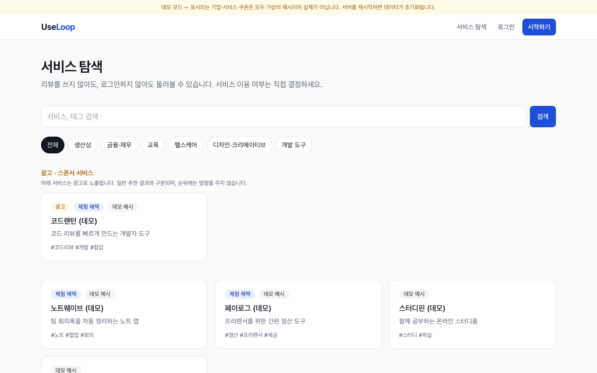
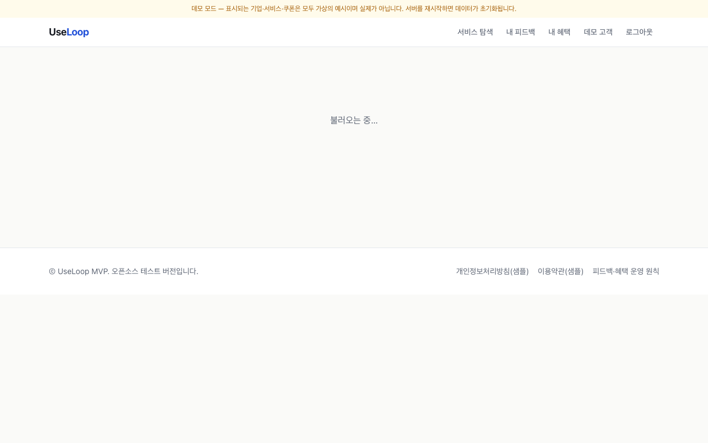
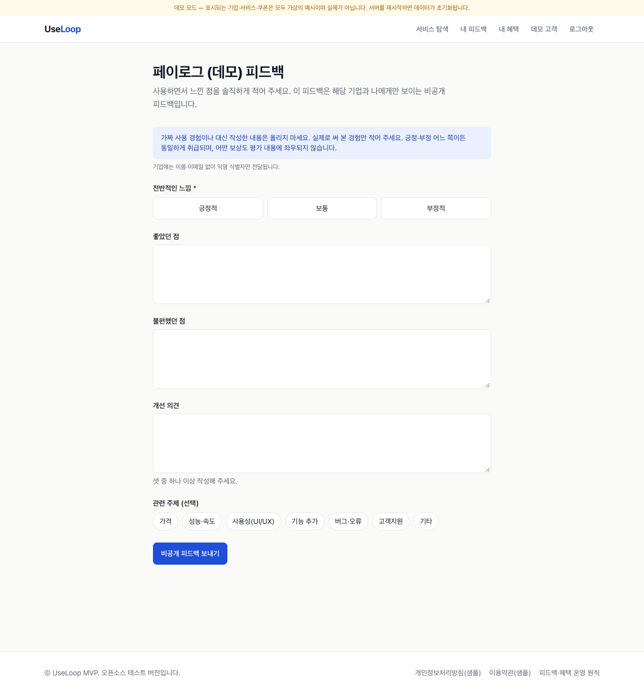
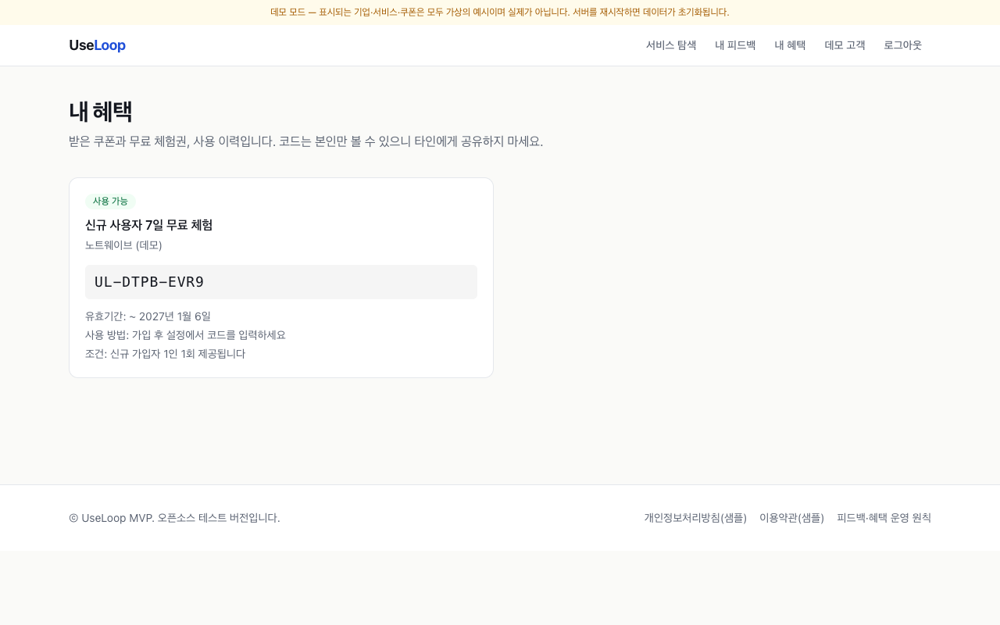
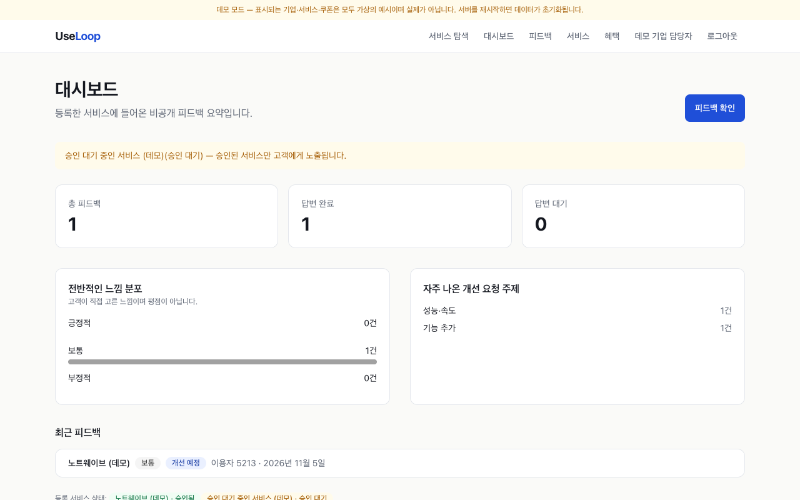
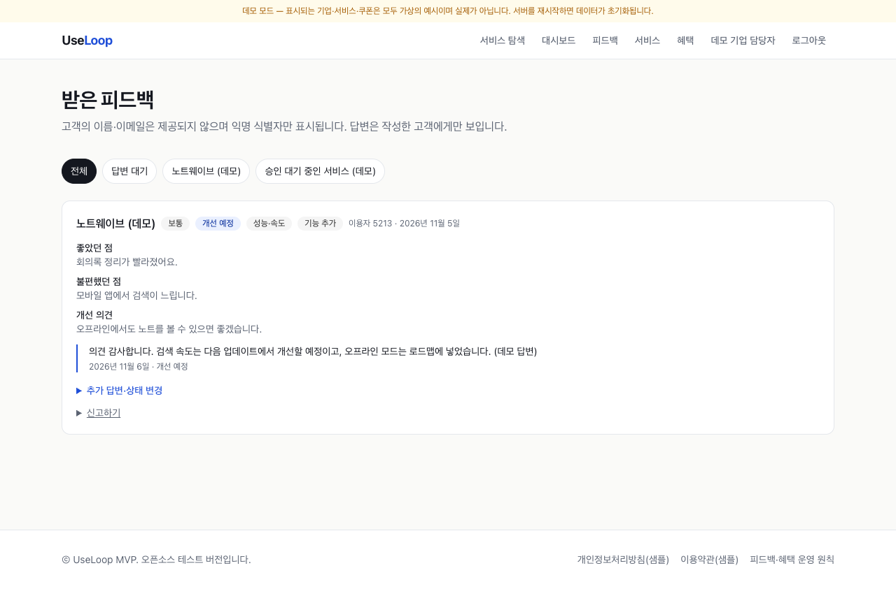
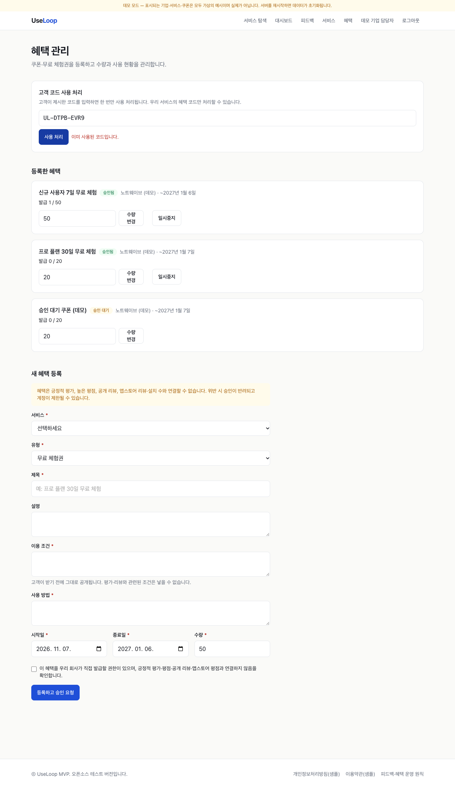
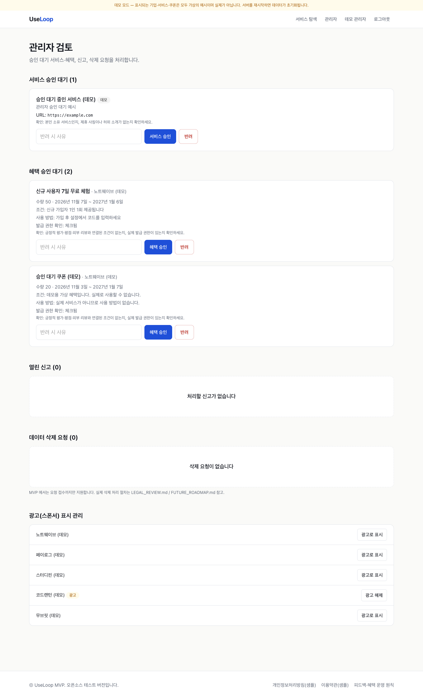
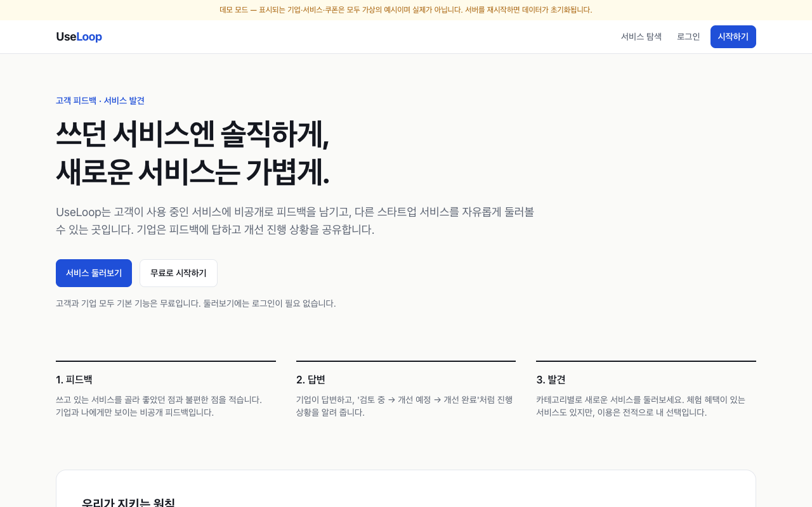
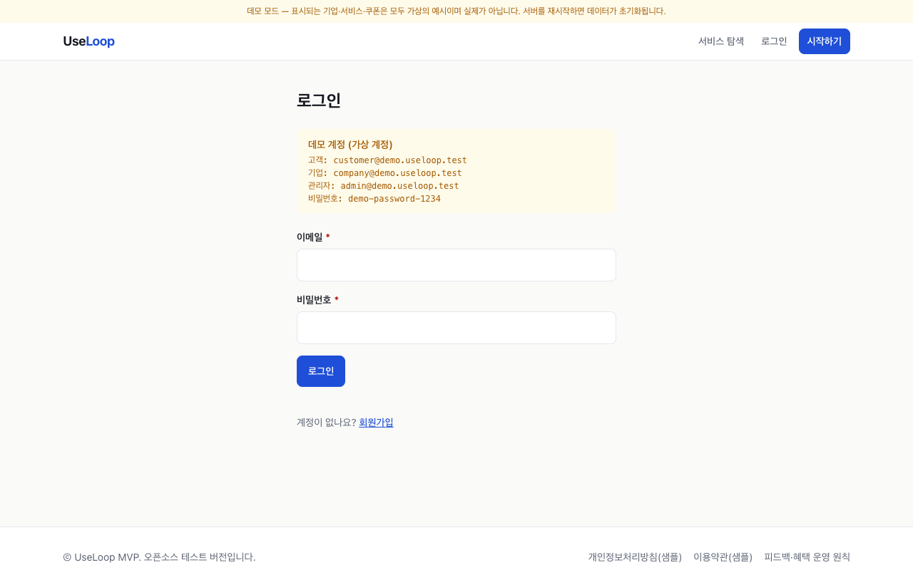

<div align="center">

# UseLoop

**고객의 자발적인 피드백과 기업의 응답·체험 혜택을 잇는 양방향 피드백 플랫폼**

Next.js 16 · React 19 · TypeScript · 설치형 PWA · Supabase (Postgres + RLS) · Tailwind CSS 4 · Vitest

**🌐 언어: [English](README.md) · 한국어**



</div>

---

> **상태: 포트폴리오용 MVP — 로컬 Demo만 가능, 운영 불가.** Supabase 경로는 실제 인스턴스에서 검증되지 않았습니다. [개발 상태](#개발-상태) 참고.

## 제품 철학

UseLoop는 서비스를 **의무적으로 테스트**시키는 플랫폼이 아닙니다. 고객은 **자발적으로** 서비스를 둘러보고 사용하고 피드백을 남기며, 기업은 **응답**하고 체험 혜택을 제공할 수 있습니다.

- 피드백은 비공개(작성자와 해당 기업만 열람)이며 긍정·부정 모두 동일하게 취급합니다.
- 혜택은 긍정 평가·평점·공개 리뷰·앱스토어 평점과 연결되지 않습니다. 평점/리뷰와 보상을 연결한 문구는 서버에서 거절하고 관리자 승인 때 다시 확인합니다.
- 피드백 "감사 혜택"은 법률 검토 전까지 **비활성**입니다(환경변수와 DB 설정 모두 `false`).
- 기업에는 익명 식별자만 전달되며 이름·이메일은 제공하지 않습니다.

## 사용 방법 영상 (한국어 자막)

탐색 → 자발적 피드백 → 기업 답변 → 혜택 등록 → 관리자 승인 → 혜택 받기 → 코드 사용 처리까지 전체 흐름을 자막과 단계 표시로 설명합니다. Demo Mode(가상 데이터)의 실제 앱 화면을 녹화했습니다.

[](docs/demo/useloop-demo-ko.mp4)

▶ [전체 영상 (MP4)](docs/demo/useloop-demo-ko.mp4)

## 화면

모두 Demo Mode(가상 데이터)의 실제 실행 화면이며 `npm run e2e:capture` 로 재생성할 수 있습니다.

| 고객 — 서비스 탐색 (로그인 불필요) | 고객 — 서비스 상세·혜택 |
|---|---|
|  |  |
| **고객 — 비공개 피드백 작성** | **고객 — 내 혜택 (발급 코드)** |
|  |  |
| **기업 — 대시보드** | **기업 — 피드백·답변** |
|  |  |
| **기업 — 혜택·코드 사용 처리** | **관리자 — 승인 대기열** |
|  |  |

<details><summary>홈·로그인 화면</summary>




</details>

## 사용자 흐름

| 역할 | 흐름 |
|---|---|
| 고객 | 가입 없이 탐색 → (선택) 로그인 → 비공개 피드백 작성 → 기업 답변·진행 상황 확인 → 원하면 혜택 받기·코드 확인 |
| 기업 | 서비스 등록(관리자 승인) → 피드백 조회·답변·진행 상태·기본 통계 → 쿠폰/무료 체험 등록(관리자 승인) → 고객 코드 1회 사용 처리 |
| 관리자 | 서비스·혜택 승인/반려(평점 연계·발급 권한 체크리스트) → 신고 처리 → 삭제 요청 확인 → 광고 라벨 관리 |

## 아키텍처

```
Next.js App Router (서버 컴포넌트 + Server Actions)
├─ src/app            화면·액션 (입력 파싱만)
├─ src/lib/services   도메인 규칙, 권한 검사, zod 검증, Rate Limit
├─ src/lib/store      Store 인터페이스
│   ├─ memory.ts      Demo Mode: 인메모리 + 서명 쿠키 세션
│   └─ supabase.ts    운영: anon key + 사용자 JWT → RLS 항상 적용 (service-role 키 미사용)
└─ supabase/migrations/0001_init.sql   스키마, RLS, 컬럼 권한, 트리거, RPC(claim_benefit, redeem_claim)
```

- **이중 방어:** 서비스 계층 권한 검사 + DB RLS/트리거.
- **쿠폰:** 수량·사용자당 1회·1회 사용을 DB 함수(행 잠금 + 제약)에서 원자적으로 처리.
- **Demo Mode fail-closed:** 운영에서 Supabase 값이 있으면 무시, 둘 다 없으면 기동 거부.

자세히: [ARCHITECTURE.md](ARCHITECTURE.md) · [DATABASE_SCHEMA.md](DATABASE_SCHEMA.md)

## 검증 결과

| 검증 | 범위 | 결과 | 명령 |
|---|---|---|---|
| 단위/도메인 테스트 | 인증·권한, 피드백, 혜택, Demo Mode 판정, 보상-평가 분리 문구 | 54건 통과 | `npm test` |
| 브라우저 E2E (Demo) | 탐색 → 피드백 → 혜택 등록 → 관리자 승인 → 수령 → 사용 처리 → 권한 경계 | 18/18 통과 | `npm run e2e:capture` |
| SQL/RLS 스모크 (순수 PostgreSQL 17 + auth 스텁) | 사용자·기업 간 격리, 권한 상승, 자가 승인, 쿠폰 중복/수량/이중 사용, 수량 3에 10명 동시 요청 → 정확히 3건 | 45개 점검 + 동시성 통과 | `npm run test:rls-local` |
| lint · typecheck · build | | 통과 | `npm run lint && npm run typecheck && npm run build` |
| **실제 Supabase 통합 테스트** | RLS·권한 상승·쿠폰 동시성 | **미실행 — 검증되지 않음** | `tests/integration/supabase-rls.test.ts` |

> SQL 스모크는 최소 `auth` 스텁을 둔 순수 Postgres에서 실행했습니다. Supabase(GoTrue/PostgREST/JWT)가 **아니며** 통합 테스트를 대체하지 않습니다.

## 빠른 시작 (Demo Mode)

```bash
npm install
cp .env.example .env.local     # DEMO_MODE=true 포함
npm run dev                    # http://localhost:3000
```

데모 데이터는 인메모리 가상 데이터(`[데모]` 표시)이며 상단 배너가 항상 표시됩니다. 운영 빌드로 데모를 띄울 때는 `DEMO_MODE=true` 를 명시해야 합니다. 데모 계정(로컬 전용, 비밀번호 `demo-password-1234`): `customer@demo.useloop.test`, `company@demo.useloop.test`, `admin@demo.useloop.test`.

**언어:** 상단의 언어 선택(한국어/English)으로 화면 전체를 전환하며 선택은 1년간 기억됩니다. 사용자·기업이 직접 쓴 내용은 원문 그대로 표시됩니다.

**설치형 PWA:** 데스크톱·안드로이드의 지원 브라우저에서는 상단의 **앱 설치**를, iPhone/iPad Safari에서는 공유 메뉴의 **홈 화면에 추가**를 사용하세요. 계정과 피드백 데이터는 보안을 위해 오프라인 캐시에 저장하지 않습니다.

영상·스크린샷 재생성: 데모 서버를 `-p 3100` 으로 새로 띄운 뒤 `npm run e2e:capture`, `npm run demo:record` (설치된 Chrome 사용).

## 환경변수

| 이름 | 설명 |
|---|---|
| `DEMO_MODE` | `true` 로 **명시**할 때만 데모. 운영에서는 설정하지 않음 |
| `NEXT_PUBLIC_SUPABASE_URL`, `NEXT_PUBLIC_SUPABASE_ANON_KEY` | Supabase 프로젝트 값. 운영에서 둘 다 있으면 항상 운영 모드 |
| `SESSION_SECRET` | 데모 세션 쿠키 서명용 |
| `FEATURE_FEEDBACK_THANKS` | 피드백 감사 혜택. 법률 검토 전까지 `false` |
| `FEATURE_SPONSORED_LABEL` | 광고 라벨/분리 노출 |

service-role 키는 사용하지 않으며 `.env*` 는 `.gitignore` 대상입니다.

## 개발 상태

| 영역 | 상태 |
|---|---|
| 로컬 Demo Mode | ✅ 동작·검증됨 |
| Supabase SQL 로직(스키마/RLS/RPC) | 🟡 순수 Postgres에서만 검증 |
| 앱 ↔ 실제 Supabase 경로 | ❌ **검증되지 않음** |
| 공개 서비스 출시 | ❌ 아직 불가 |

**출시 전 필수:** 실제 Supabase 통합 테스트 실행, 약관·개인정보처리방침 법률 검토(현재 **샘플**), **계정·데이터 삭제 절차**(현재는 요청 표시만), 분산 Rate Limit(현재 프로세스 메모리), 이메일 인증·봇 방지. 스팸·다중 계정·허위 리뷰·쿠폰 악용·광고 표시 리스크와 개선안은 [docs/PRELAUNCH_CHECKLIST.md](docs/PRELAUNCH_CHECKLIST.md), [LEGAL_REVIEW.md](LEGAL_REVIEW.md) 참고.

**운영 설정 (미검증 경로):** Supabase 프로젝트 생성 → 이메일 가입·확인 활성화 → `supabase/migrations/0001_init.sql` 실행 → Supabase 환경변수 2개 설정(`DEMO_MODE` 미설정) → SQL로 관리자 승격 → 배포 전 **테스트 전용 프로젝트**에서 통합 테스트 실행.

```bash
SUPABASE_TEST_URL=... SUPABASE_TEST_ANON_KEY=... SUPABASE_TEST_ADMIN_EMAIL=... SUPABASE_TEST_ADMIN_PASSWORD=... npm test
```

## 문서

[ARCHITECTURE.md](ARCHITECTURE.md) · [DATABASE_SCHEMA.md](DATABASE_SCHEMA.md) · [LEGAL_REVIEW.md](LEGAL_REVIEW.md) · [docs/PRELAUNCH_CHECKLIST.md](docs/PRELAUNCH_CHECKLIST.md) · [FUTURE_ROADMAP.md](FUTURE_ROADMAP.md)

---

## Copyright & Usage / 저작권 및 이용 안내

Copyright © 2026 Sihun Wang. All Rights Reserved.

This project is publicly available for viewing and portfolio demonstration purposes.

All rights to the original source code, documentation, designs, and project-specific assets are reserved by the author.

No permission is granted to reproduce, modify, redistribute, or commercially use the original materials without prior written authorization, except as permitted by applicable law or GitHub's Terms of Service.

Third-party libraries, dependencies, and other externally sourced materials remain subject to their respective licenses and ownership rights.

For licensing, collaboration, or commercial inquiries, please contact the repository owner.

---

저작권 © 2026 Sihun Wang. 모든 권리 보유.

이 프로젝트는 열람 및 포트폴리오 시연 목적으로 공개되어 있습니다.

원본 소스 코드, 문서, 디자인 및 프로젝트 고유 자산에 대한 모든 권리는 저작자에게 있습니다.

관련 법령 또는 GitHub 이용약관이 허용하는 범위를 제외하고, 사전 서면 허가 없이 원본 자료를 복제, 수정, 재배포하거나 상업적으로 이용할 수 있는 권한은 부여되지 않습니다.

제3자 라이브러리, 의존성 및 외부에서 가져온 자료는 각각의 라이선스와 소유권에 따릅니다.

라이선스, 협업 또는 상업적 문의는 저장소 소유자에게 연락해 주세요.
