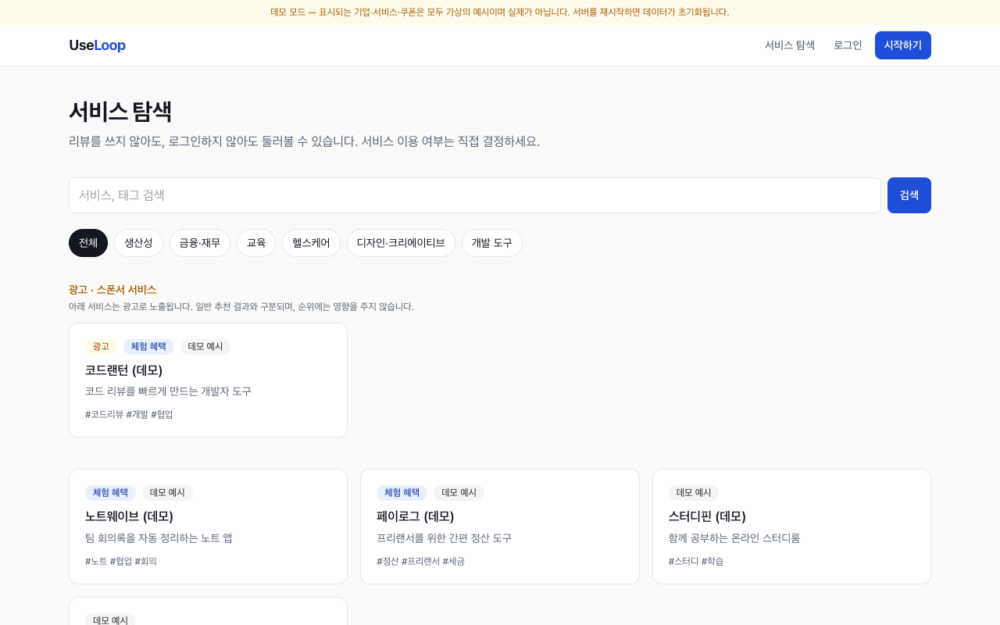
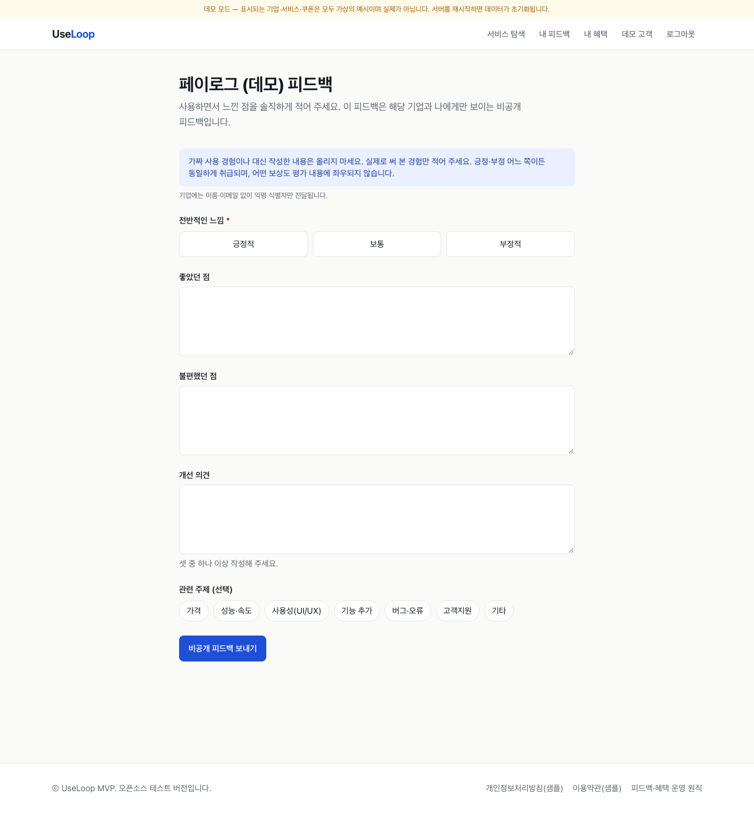
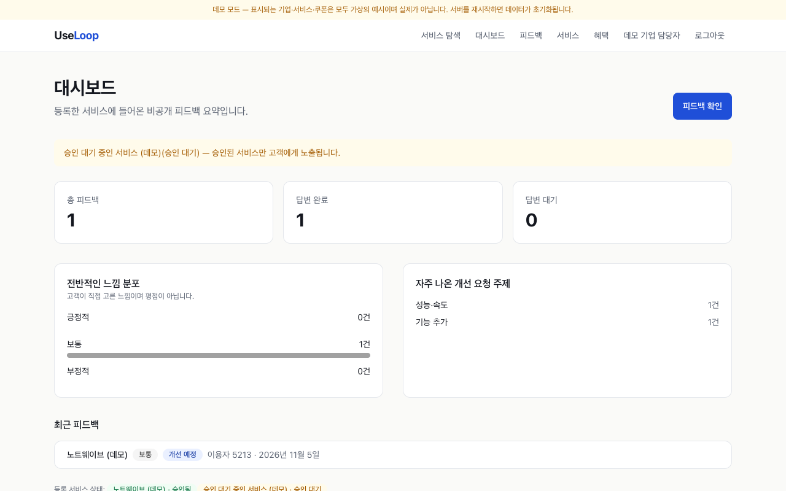
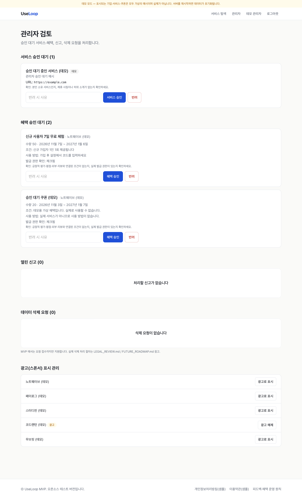
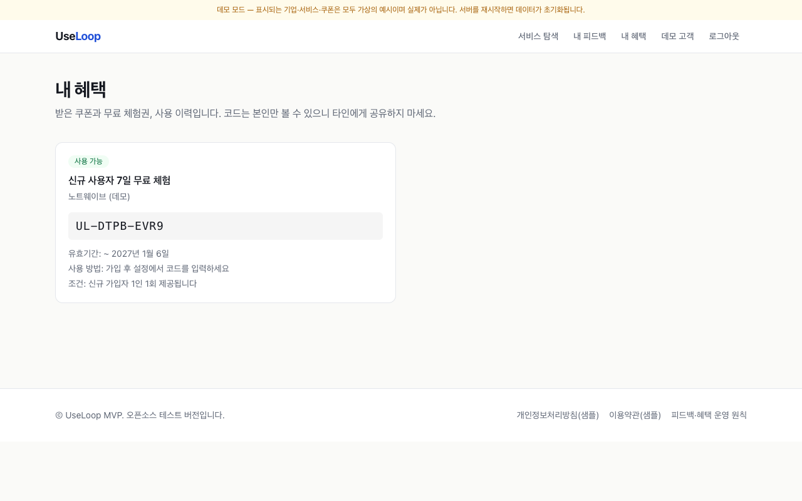
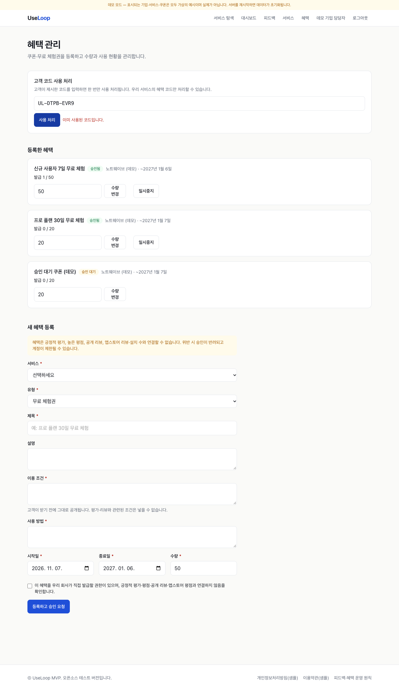

# UseLoop

> 고객의 **자발적인** 서비스 탐색·사용·피드백과, 기업의 **응답·체험 혜택**을 잇는 양방향 피드백 플랫폼 (Next.js · Supabase)

UseLoop 는 서비스를 "의무적으로 테스트"시키는 곳이 아닙니다. 고객은 원할 때만 서비스를 둘러보고 비공개 피드백을 남기며, 기업은 답변과 진행 상황으로 응답하고 체험 혜택을 제공합니다. **혜택은 긍정적 평가·평점·공개 리뷰와 연결되지 않으며**, 피드백은 긍정·부정 모두 동일하게 취급됩니다.

| 고객 – 서비스 탐색 (로그인 불필요) | 고객 – 비공개 피드백 작성 |
|---|---|
|  |  |
| **기업 – 대시보드** | **관리자 – 승인 대기열** |
|  |  |

<sub>모든 화면은 Demo Mode(가상 데이터)에서 실제 앱을 실행해 `npm run e2e:capture` 로 캡처했습니다. 더 많은 화면: [docs/screenshots](docs/screenshots)</sub>

## 개발 상태 (먼저 읽어 주세요)

| 구분 | 상태 |
|---|---|
| 로컬 Demo Mode | ✅ 동작·검증됨 |
| Supabase SQL(스키마/RLS/RPC) 로직 | 🟡 순수 PostgreSQL + auth 스텁에서만 검증 (실제 Supabase **아님**) |
| 실제 Supabase 연동 앱 경로 | ❌ **검증되지 않음** (통합 테스트 코드는 있으나 미실행) |
| 공개 서비스 출시 | ❌ 불가 — 법률 검토·개인정보 삭제 절차·분산 Rate Limit 등 필요 → [출시 전 체크리스트](docs/PRELAUNCH_CHECKLIST.md) |

법률 안내 문구(약관·개인정보처리방침)는 모두 **샘플**입니다 → [LEGAL_REVIEW.md](LEGAL_REVIEW.md)

## 사용자 경험

**고객** — 가입 없이 서비스 탐색 → (선택) 로그인 후 비공개 피드백 작성 → 기업 답변·진행 상황(검토 중/개선 예정/개선 완료) 확인 → 원하면 체험 혜택 받기·내 혜택에서 코드 확인. 피드백을 쓰지 않아도 혜택을 받을 수 있고, 어떤 혜택도 피드백 내용에 좌우되지 않습니다.

**기업** — 서비스 등록(관리자 승인) → 받은 피드백 조회(이름·이메일 없이 익명 식별자)·답변·진행 상태 변경·기본 통계 → 쿠폰/무료 체험 등록(관리자 승인)·수량·일시중지 → 고객이 제시한 코드 사용 처리(1회).

**관리자** — 서비스·혜택 승인/반려(평점 연계 조건·발급 권한 확인 체크리스트 표시), 신고 처리, 삭제 요청 확인, 광고(스폰서) 표시 관리.

| 내 혜택(고객) | 혜택 관리(기업) |
|---|---|
|  |  |

## Architecture

```
Next.js App Router (서버 컴포넌트 + Server Actions)
 └─ src/app            화면·액션 (입력 파싱만)
 └─ src/lib/services   도메인 규칙·권한 검사 (zod 검증, 역할/소유권, Rate Limit)
 └─ src/lib/store      Store 인터페이스
      ├─ memory.ts     Demo Mode: 인메모리 + 서명 쿠키 세션
      └─ supabase.ts   운영: anon key + 사용자 JWT → RLS 가 항상 적용 (service-role 키 미사용)
 └─ supabase/migrations/0001_init.sql   스키마 · RLS · 컬럼 권한 · 트리거 · RPC(claim_benefit, redeem_claim)
```
- 권한은 **이중 방어**: 서비스 계층 검사 + DB RLS/트리거. 쿠폰 수량·중복·코드 사용은 DB 함수(행 잠금)에서 원자적으로 처리.
- Demo Mode 는 fail-closed: 운영(`NODE_ENV=production`)에서 Supabase 값이 있으면 무시되고, 설정이 없으면 기동 거부.
- 자세한 내용: [ARCHITECTURE.md](ARCHITECTURE.md) · [DATABASE_SCHEMA.md](DATABASE_SCHEMA.md)

## 검증된 기능

| 검증 | 범위 | 결과 | 실행 |
|---|---|---|---|
| 단위/도메인 테스트 | 인증·권한, 피드백, 혜택 승인·발급·사용, Demo Mode 판정, 보상-평가 분리 문구 | 54 통과 | `npm test` |
| 브라우저 E2E (Demo) | 탐색→피드백→기업 혜택 등록→관리자 승인→고객 수령→기업 사용 처리→권한 경계 | 18/18 통과 | `npm run e2e:capture` |
| SQL/RLS 스모크 (순수 PostgreSQL 17 + auth 스텁) | 사용자·기업 간 격리, 권한 상승, 혜택 자가 승인, 쿠폰 중복/수량/이중 사용, 10명 동시 요청(수량 3 → 정확히 3건) | 45 점검 + 동시성 통과 | `npm run test:rls-local` |
| lint / typecheck / build | | 통과 | `npm run lint && npm run typecheck && npm run build` |
| 실제 Supabase 통합 테스트 | RLS·권한 상승·쿠폰 동시성 | **미실행 (검증되지 않음)** | `tests/integration/supabase-rls.test.ts` (테스트 전용 프로젝트 필요) |

## 빠른 시작 (Demo Mode — Supabase 불필요)
```bash
npm install
cp .env.example .env.local   # DEMO_MODE=true 가 들어 있습니다
npm run dev                  # http://localhost:3000
```
데모 모드는 **인메모리 저장소**를 사용하며 서버를 재시작하면 초기화됩니다. 모든 기업·서비스·쿠폰은 `[데모]`/`(데모)` 로 표시되는 **가상 데이터**이며, 화면 상단에 데모 배너가 항상 표시됩니다. 운영 빌드로 데모를 띄울 때도 `DEMO_MODE=true` 를 명시해야 합니다(`DEMO_MODE=true npm run build && DEMO_MODE=true npm start`).

데모 계정 (로컬 전용, 비밀번호 `demo-password-1234`):

| 역할 | 이메일 |
|---|---|
| 고객 | customer@demo.useloop.test |
| 기업 | company@demo.useloop.test |
| 관리자 | admin@demo.useloop.test |

스크린샷·E2E 재생성: 데모 서버를 `-p 3100` 으로 띄운 뒤 `npm run e2e:capture` (설치된 Chrome 사용).

## 환경변수
| 이름 | 설명 |
|---|---|
| `DEMO_MODE` | `true` 로 **명시**할 때만 데모. 운영에서는 설정하지 않거나 `false` |
| `NEXT_PUBLIC_SUPABASE_URL`, `NEXT_PUBLIC_SUPABASE_ANON_KEY` | Supabase 프로젝트 값. 운영(`NODE_ENV=production`)에서 둘 다 있으면 항상 운영 모드 |
| `SESSION_SECRET` | 데모 모드 세션 쿠키 서명용 |
| `FEATURE_FEEDBACK_THANKS` | 피드백 감사 혜택. **법률 검토 전까지 `false`** (DB `app_settings` 도 false) |
| `FEATURE_SPONSORED_LABEL` | 광고 라벨/분리 노출 |

service-role 키는 사용하지 않습니다(anon key + 사용자 JWT 로만 DB 접근 → RLS 항상 적용). `.env*` 는 `.gitignore` 대상입니다.

## 운영 모드 (Supabase) — ⚠️ 미검증 경로
1. Supabase 프로젝트 생성 → Authentication 에서 이메일 가입·**이메일 확인** 활성화
2. [`supabase/migrations/0001_init.sql`](supabase/migrations/0001_init.sql) 실행
3. `.env.local`(또는 호스팅 환경변수)에 URL/anon key 입력, `DEMO_MODE` 미설정
4. 관리자 지정: 가입 후 SQL 로 `update profiles set role='admin' where email='...'`
5. **테스트 전용 프로젝트**에서 통합 테스트 실행 후에만 `npm run build && npm start`
```bash
SUPABASE_TEST_URL=... SUPABASE_TEST_ANON_KEY=... SUPABASE_TEST_ADMIN_EMAIL=... SUPABASE_TEST_ADMIN_PASSWORD=... npm test
```
배포(Vercel)는 위 검증과 [체크리스트](docs/PRELAUNCH_CHECKLIST.md) 완료 후에만 권장합니다. Rate Limit 은 프로세스 메모리 기반이라 서버리스에서는 Redis 등으로 교체해야 합니다. 데모 모드는 서버리스에 부적합합니다.

## 문서
[ARCHITECTURE.md](ARCHITECTURE.md) · [DATABASE_SCHEMA.md](DATABASE_SCHEMA.md) · [LEGAL_REVIEW.md](LEGAL_REVIEW.md) · [출시 전 체크리스트](docs/PRELAUNCH_CHECKLIST.md) · [FUTURE_ROADMAP.md](FUTURE_ROADMAP.md)

## Copyright & Usage / 저작권 및 이용 안내

Copyright © 2026 Sihun Wang. All Rights Reserved.

This project is publicly available for viewing and portfolio demonstration purposes.

All rights to the original source code, documentation, designs, and project-specific assets are reserved by the author.

No permission is granted to reproduce, modify, redistribute, or commercially use the original materials without prior written authorization, except as permitted by applicable law or GitHub's Terms of Service.

Third-party libraries, dependencies, and other externally sourced materials remain subject to their respective licenses and ownership rights.

For licensing, collaboration, or commercial inquiries, please contact the repository owner.

---

저작권 © 2026 Sihun Wang. 모든 권리 보유.

이 프로젝트는 열람 및 포트폴리오 시연 목적으로 공개되어 있습니다.

원본 소스 코드, 문서, 디자인 및 프로젝트 고유 자산에 대한 모든 권리는 저작자에게 있습니다.

관련 법령 또는 GitHub 이용약관이 허용하는 범위를 제외하고, 사전 서면 허가 없이 원본 자료를 복제, 수정, 재배포하거나 상업적으로 이용할 수 있는 권한은 부여되지 않습니다.

제3자 라이브러리, 의존성 및 외부에서 가져온 자료는 각각의 라이선스와 소유권에 따릅니다.

라이선스, 협업 또는 상업적 문의는 저장소 소유자에게 연락해 주세요.
