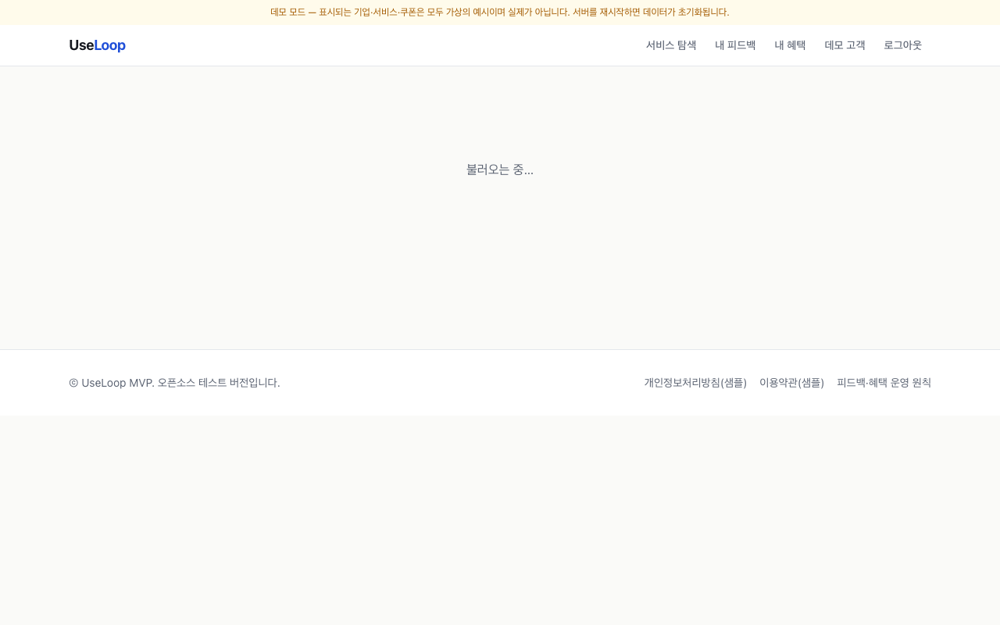
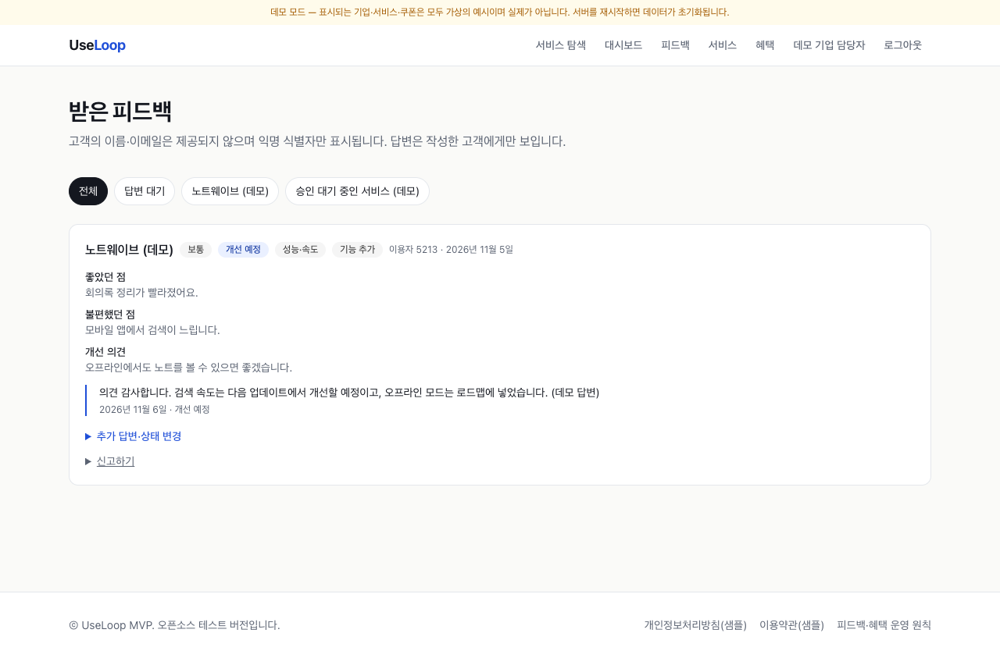
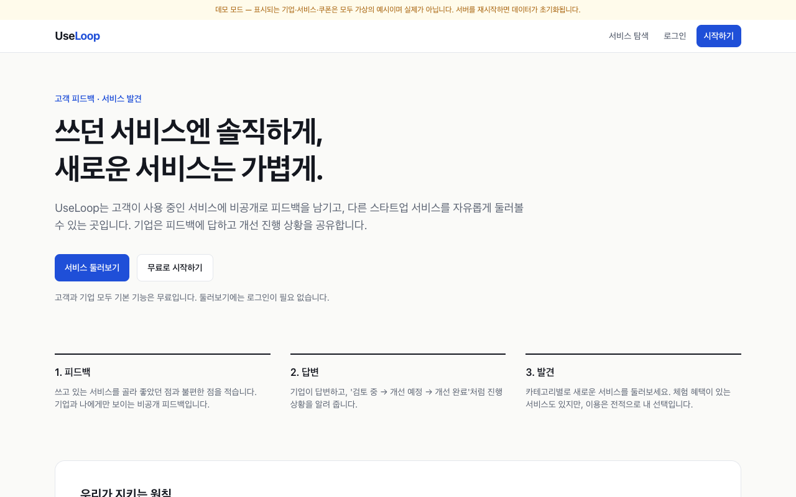
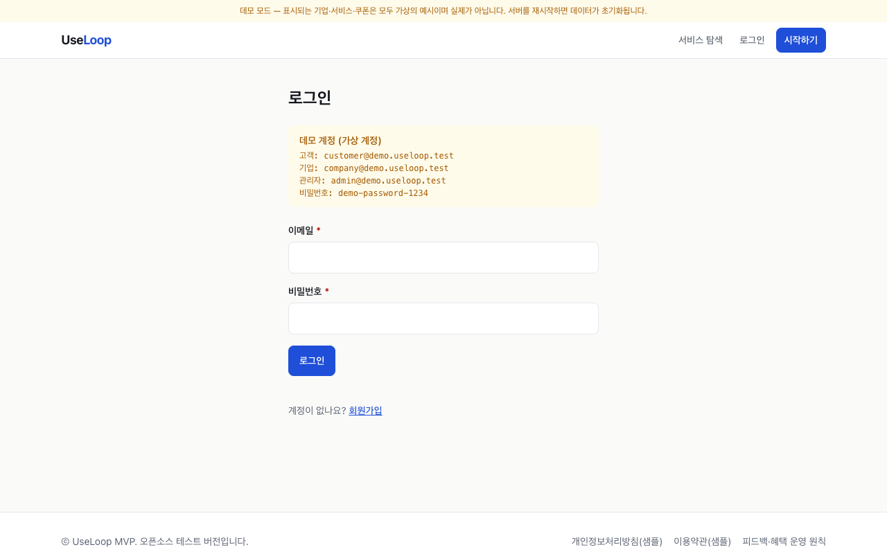

<div align="center">

# UseLoop

**A two-way feedback platform connecting voluntary customer feedback with company responses and trial benefits.**

Next.js 16 · React 19 · TypeScript · Installable PWA · Supabase (Postgres + RLS) · Tailwind CSS 4 · Vitest

**🌐 Language: English · [한국어](README.ko.md)**


</div>

---

> **Status: portfolio MVP — local Demo only. Not production-ready.** The Supabase path has not been verified against a real instance. See [Development status](#development-status).

## Philosophy

UseLoop is **not** a platform that obliges people to test services. Customers browse, use and give feedback **voluntarily**; companies **respond** and may offer trial benefits.

- Feedback is private (visible only to the author and the company) and treated identically whether positive or negative.
- Benefits are never tied to positive reviews, ratings, public reviews or app-store ratings. Benefit copy that links rewards to ratings/reviews is rejected server-side and checked again by admin review.
- "Thank-you" benefits for feedback are **disabled** (env flag and DB setting both `false`) pending legal review.
- Companies see an anonymous identifier only — never a customer's name or email.

## Demo video (Korean, with captions)

A narrated-by-captions walkthrough of the whole loop — discover → voluntary feedback → company reply → benefit submission → admin approval → claim → redeem. Recorded from the running app in Demo Mode (fictional data).

[](docs/demo/useloop-demo-ko.mp4)

▶ [Full video (MP4)](docs/demo/useloop-demo-ko.mp4) · Captions are in Korean; the app itself can be switched to English with the header language selector.

## Screenshots

All captured from the running app in Demo Mode (fictional data) via `npm run e2e:capture`. UI text is Korean.

| Customer — discover (no login) | Customer — service detail & benefits |
|---|---|
|  |  |
| **Customer — private feedback form** | **Customer — my benefits (claim code)** |
|  |  |
| **Company — dashboard** | **Company — feedback & replies** |
|  |  |
| **Company — benefits & code redemption** | **Admin — approval queue** |
|  |  |

<details><summary>Home & login (Demo)</summary>




</details>

## User flows

| Role | Flow |
|---|---|
| Customer | Browse without an account → (optional) sign in → write private feedback → see company replies and progress → optionally claim a benefit and view the code |
| Company | Register a service (admin-approved) → read/answer feedback, set progress, basic stats → submit coupons/free trials (admin-approved) → redeem customer codes once |
| Admin | Approve/reject services and benefits (checklist: no rating linkage, issuer authority) → handle reports → review deletion requests → manage sponsored ("Ad") labels |

## Architecture

```
Next.js App Router (Server Components + Server Actions)
├─ src/app            pages & actions (input parsing only)
├─ src/lib/services   domain rules, authorization, zod validation, rate limits
├─ src/lib/store      Store interface
│   ├─ memory.ts      Demo Mode: in-memory + signed-cookie session
│   └─ supabase.ts    Production: anon key + user JWT → RLS always applies (no service-role key)
└─ supabase/migrations/0001_init.sql   schema, RLS, column grants, triggers, RPC (claim_benefit, redeem_claim)
```

- **Defense in depth:** service-layer checks plus database RLS/triggers.
- **Coupons:** quantity, per-user uniqueness and single redemption are enforced atomically in DB functions (row lock + constraints).
- **Demo Mode is fail-closed:** ignored in production when Supabase is configured; the app refuses to start when neither is configured.

More: [ARCHITECTURE.md](ARCHITECTURE.md) · [DATABASE_SCHEMA.md](DATABASE_SCHEMA.md)

## Verification

| Check | Scope | Result | Command |
|---|---|---|---|
| Unit / domain tests | auth, permissions, feedback, benefits, Demo-mode guard, reward-wording guard | 54 pass | `npm test` |
| Browser E2E (Demo) | discover → feedback → benefit submit → admin approve → claim → redeem → role boundaries | 18/18 pass | `npm run e2e:capture` |
| SQL/RLS smoke (plain PostgreSQL 17 + auth stub) | user/company isolation, privilege escalation, self-approval, coupon duplicate/quantity/double-redeem, 10 concurrent claims on qty 3 → exactly 3 | 45 checks + concurrency pass | `npm run test:rls-local` |
| lint · typecheck · build | | pass | `npm run lint && npm run typecheck && npm run build` |
| **Real Supabase integration** | RLS, privilege escalation, coupon concurrency | **Not run — unverified** | `tests/integration/supabase-rls.test.ts` |

> The SQL smoke test runs on plain Postgres with a minimal `auth` stub. It is **not** Supabase (GoTrue/PostgREST/JWT) and does not replace integration testing.

## Quick start (Demo Mode)

```bash
npm install
cp .env.example .env.local     # contains DEMO_MODE=true
npm run dev                    # http://localhost:3000
```

Demo data is in-memory and fictional (labelled "[데모]"); a banner is always shown. For a production build, set `DEMO_MODE=true` explicitly. Demo accounts (local only, password `demo-password-1234`): `customer@demo.useloop.test`, `company@demo.useloop.test`, `admin@demo.useloop.test`.

The app is an installable hybrid PWA. In a supported desktop or Android browser, use **앱 설치** in the header. On iPhone/iPad, open Safari's Share menu and choose **Add to Home Screen**. Account and feedback data is intentionally not cached offline.

The header language selector switches the interface between Korean and English and remembers the choice for one year. Text authored by users and companies is left in its original language.

## Environment variables

| Name | Description |
|---|---|
| `DEMO_MODE` | Demo only when explicitly `true`. Leave unset in production |
| `NEXT_PUBLIC_SUPABASE_URL`, `NEXT_PUBLIC_SUPABASE_ANON_KEY` | Supabase project. In production, if both are set the app is always in production mode |
| `SESSION_SECRET` | Signs the demo session cookie |
| `FEATURE_FEEDBACK_THANKS` | Thank-you benefits. Keep `false` until legal review |
| `FEATURE_SPONSORED_LABEL` | Ad label and separate placement |

No service-role key is used. `.env*` files are git-ignored.

## Development status

| Area | Status |
|---|---|
| Local Demo Mode | ✅ Working, verified |
| Supabase SQL logic (schema/RLS/RPC) | 🟡 Verified on plain Postgres only |
| App ↔ real Supabase path | ❌ **Unverified** |
| Public launch | ❌ Not possible yet |

Launch blockers: real-Supabase integration run; legal review of terms/privacy (current text is a **sample**); **account/data deletion workflow** (only a request flag exists today); distributed rate limiting (currently in-process memory); email verification and bot protection. Details, risk review (spam, multi-accounts, fake reviews, coupon abuse, ads) and proposals: [docs/PRELAUNCH_CHECKLIST.md](docs/PRELAUNCH_CHECKLIST.md) · [LEGAL_REVIEW.md](LEGAL_REVIEW.md).

**Production setup (unverified path):** create a Supabase project → enable email sign-up with confirmation → run `supabase/migrations/0001_init.sql` → set the two Supabase env vars (leave `DEMO_MODE` unset) → promote an admin via SQL → run the integration test against a **dedicated test project** before deploying.

```bash
SUPABASE_TEST_URL=... SUPABASE_TEST_ANON_KEY=... SUPABASE_TEST_ADMIN_EMAIL=... SUPABASE_TEST_ADMIN_PASSWORD=... npm test
```

---

## Copyright & Usage / 저작권 및 이용 안내

Copyright © 2026 Sihun Wang. All Rights Reserved.

This project is publicly available for viewing and portfolio demonstration purposes.

All rights to the original source code, documentation, designs, and project-specific assets are reserved by the author.

No permission is granted to reproduce, modify, redistribute, or commercially use the original materials without prior written authorization, except as permitted by applicable law or GitHub's Terms of Service.

Third-party libraries, dependencies, and other externally sourced materials remain subject to their respective licenses and ownership rights.

For licensing, collaboration, or commercial inquiries, please contact the repository owner.

---

저작권 © 2026 Sihun Wang. 모든 권리 보유.

이 프로젝트는 열람 및 포트폴리오 시연 목적으로 공개되어 있습니다.

원본 소스 코드, 문서, 디자인 및 프로젝트 고유 자산에 대한 모든 권리는 저작자에게 있습니다.

관련 법령 또는 GitHub 이용약관이 허용하는 범위를 제외하고, 사전 서면 허가 없이 원본 자료를 복제, 수정, 재배포하거나 상업적으로 이용할 수 있는 권한은 부여되지 않습니다.

제3자 라이브러리, 의존성 및 외부에서 가져온 자료는 각각의 라이선스와 소유권에 따릅니다.

라이선스, 협업 또는 상업적 문의는 저장소 소유자에게 연락해 주세요.
